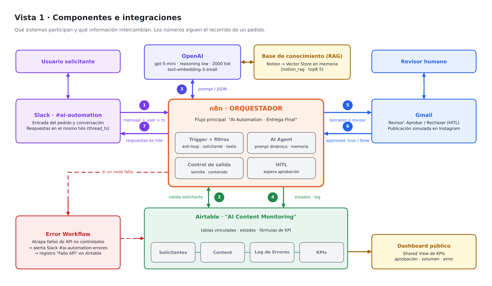
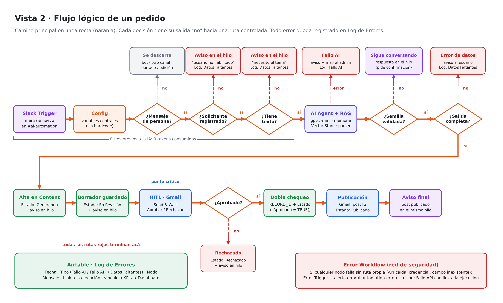

# Ecosistema de Automatización IA · Contenido de Instagram sobre trámites automotores

**Entrega Final · AI Automation · Coderhouse**
Alumno: **Ricardo Josa**

Ecosistema autónomo que genera contenido educativo para Instagram sobre trámites automotores en Argentina (transferencias, verificación policial, formularios, costos, mitos y errores frecuentes). Funciona de punta a punta:

1. Un colaborador pide un post desde **Slack**.
2. Un **agente de IA con RAG** valida el tema contra una base de conocimiento propia y redacta el borrador.
3. El borrador se registra en **Airtable**.
4. Se envía a un **revisor humano por Gmail** (Human-in-the-Loop).
5. Solo con aprobación explícita, se simula la publicación y se avisa al solicitante en el mismo hilo de Slack.

---

## 🔗 Enlaces

| Recurso | Link |
|---|---|
| 📄 Documento de entrega | [Google Doc](https://docs.google.com/document/d/1pQULG1twStgdn2DjVEiNJvQl20YDuyR8ECX0SYye1T0/edit?usp=sharing) · [PDF en el repo](./docs/Entrega_Final_AI_Automation_Ricardo_Josa.pdf) |
| 🎬 Video demo (3 min) | https://youtu.be/dMU-k2jlhec |
| 📊 Dashboard de KPIs (Shared View pública) | https://airtable.com/appJBMsP4mvkNRtX8/shrcJgNW9fhlaMOKn/tblV3hHeQrxBDNDMO |
| 🗂️ Base de datos (solo lectura) · Content | https://airtable.com/appJBMsP4mvkNRtX8/shryemI2kjEcNvxUC/tblWZq3FN7hiCDuA7 |
| 🗂️ Base de datos (solo lectura) · Log de Errores | https://airtable.com/appJBMsP4mvkNRtX8/shrHJnO3isSTlKYFc/tbls7kY8zIuQFuMat |
| 🗂️ Base de datos (solo lectura) · Solicitantes | https://airtable.com/appJBMsP4mvkNRtX8/shrYu4IXhxmQBEDdP/tblzFzbB0j3b3Yv8G |

---

## 🧱 Stack

| Categoría | Herramienta | Uso |
|---|---|---|
| Orquestador | **n8n** | Flujo principal + Error Workflow |
| Base de datos | **Airtable** | 4 tablas vinculadas: Solicitantes, Content, Log de Errores, KPIs |
| Procesamiento IA | **OpenAI** | `gpt-5-mini` (agente, reasoning low, Max Tokens 2000) + `text-embedding-3-small` (RAG) |
| Base de conocimiento | **Notion** | Fuente del RAG, re-indexada a diario en un vector store en memoria |
| Canales de salida | **Slack** y **Gmail** | Conversación en hilos · aprobación HITL · publicación simulada |

---

## 🏗️ Arquitectura





---

## 📁 Estructura del repositorio

```
.
├── README.md
├── docs/
│   ├── Entrega_Final_AI_Automation_Ricardo_Josa.pdf
│   └── Entrega_Final_AI_Automation_Ricardo_Josa.docx
├── workflows/
│   ├── AI_Automation_-_Entrega_Final.json
│   └── AI_Automation_-_Entrega_Final_-_Manejo_de_Errores.json
├── diagramas/
│   ├── Arquitectura_Vista1_Componentes.png
│   └── Arquitectura_Vista2_Flujo.png
└── evidencias/
    └── (capturas del stress test)
```

---

## ✅ Requisitos técnicos cubiertos

| Requisito | Implementación |
|---|---|
| Trigger inteligente | Slack Trigger por canal + filtro anti-loop (`bot_id`, canal, `subtype`) + validación de solicitante y de texto **antes** de la IA (0 tokens en mensajes inválidos) |
| IA con prompts estructurados | AI Agent con RAG, memoria por usuario y Structured Output Parser (`estado`, `respuesta`, `semilla`, `contenido`) |
| Prompt dinámico | Variables del sistema (solicitante, fecha, mensaje) en el User Message; system message estático para aprovechar el **prompt caching** |
| Manejo de errores | Error output en el AI Agent (*Resume*) + Error Workflow global (*Break*) → registro en **Log de Errores** con link a la ejecución |
| Human-in-the-Loop | Gmail *Send & Wait* (Aprobar / Rechazar) + doble verificación en Airtable antes de publicar |
| Thread ID de Slack | `thread_ts \|\| ts` guardado en `Content.Slack_Thread_TS`; todas las respuestas van al mismo hilo |
| Sin datos hardcodeados | Nodos **Config** y **Config Errores** centralizan canales, e-mails, IDs y URL |
| Stress test | 10 escenarios: 4 caminos felices/rechazo, 6 caminos no felices y una prueba de trazabilidad del dato |

---

## 📊 KPIs al cierre del stress test

| KPI | Valor |
|---|---|
| Tasa de aprobación | **75 %** (3 de 4 piezas) |
| Volumen de salida | **3** piezas publicadas |
| Tasa de error | **50 %** (4 incidentes forzados a propósito para validar cada ruta de error) |

---

## ⚙️ Cómo importar los flujos

1. En n8n: **Create workflow → ⋯ → Import from File** y elegí cada JSON de `workflows/`.
2. Asigná tus credenciales: Slack, Gmail, Airtable, Notion y OpenAI. Los JSON no incluyen secretos, solo referencias a las credenciales.
3. Editá los nodos **Config** y **Config Errores** con tus canales de Slack, e-mails, el ID del registro de KPIs y la URL de tu instancia.
4. Publicá el **Error Workflow** y seleccionalo en *Settings → Error Workflow* del flujo principal.
5. Ejecutá una vez el bloque **Creación de RAG en BD Vectorial** para cargar la base de conocimiento. Después se recarga sola todas las noches.
6. Publicá el flujo principal.

---

## 🚀 Evolución hacia producción

Mejoras pensadas para un uso productivo. **Ninguna es requisito de la entrega.**

- Publicación real en Instagram mediante la Graph API.
- Vector store persistente (Supabase o Pinecone).
- Fecha de actualización por entrada de la base RAG.
- Manejo explícito del timeout del HITL.
- Ramas de error propias después del alta de la pieza, para vincular `Content_ID` en el Log de Errores.
